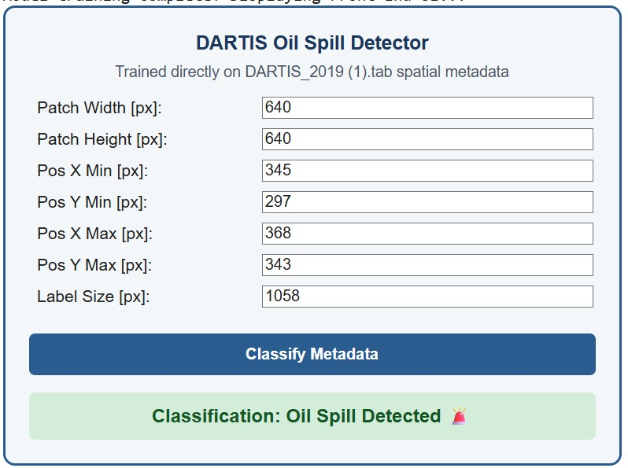

# DARTIS 2019 Oil Spill Classifier

Small PyTorch classifier that separates oil slicks from look-alikes using the spatial
metadata in the DARTIS 2019 dataset (Sentinel-1, Eastern Mediterranean).

- **Input:** `DARTIS_2019 (1).tab` (place it next to the script)
- **Features:** patch width/height, object bounding box (x/y min/max) and label size, in pixels
- **Target:** 1 = oil (`ow`, `oc` subsets), 0 = non-oil (`nw`, `nc` subsets)
- **Model:** 7 → 64 → 32 → 1 MLP, BCE-with-logits loss, Adam, 150 epochs, 80/20 stratified split
- **Output:** `predict_raw_inputs(...)` returns label, confidence and raw probability

`dartis_classifier.py` is written for a Jupyter/Colab notebook (it ends by rendering an
HTML form with `IPython.display`).

Note: the HTML form's "Classify Metadata" button uses a simple rule in JavaScript for the
demo UI; the trained model is the Python `predict_raw_inputs` function.
